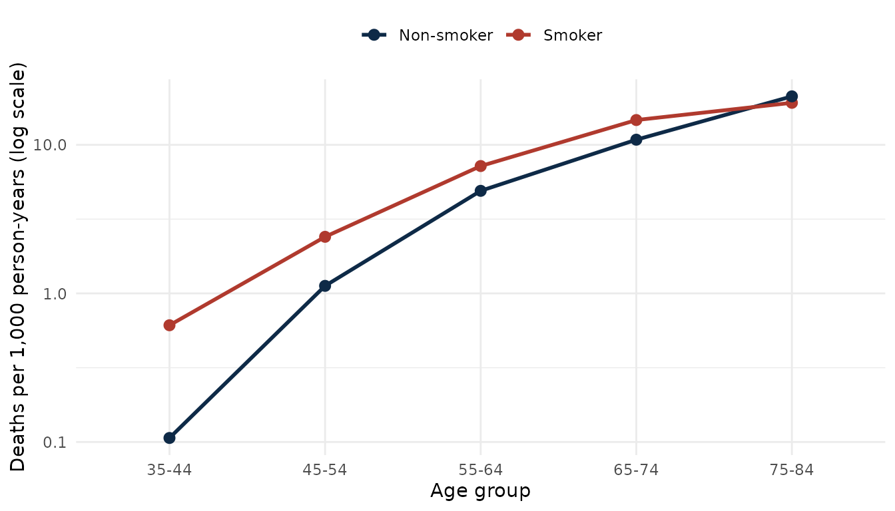
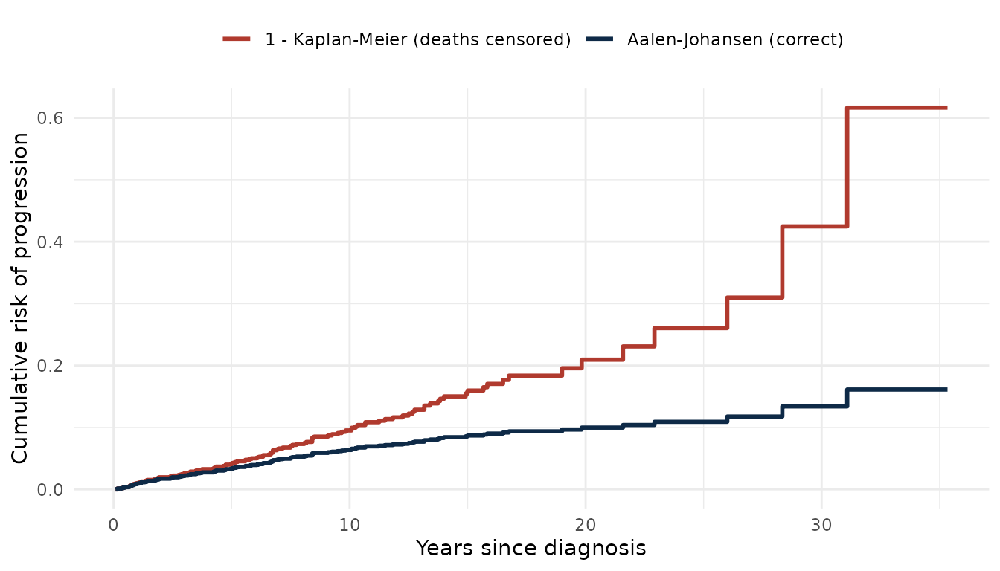
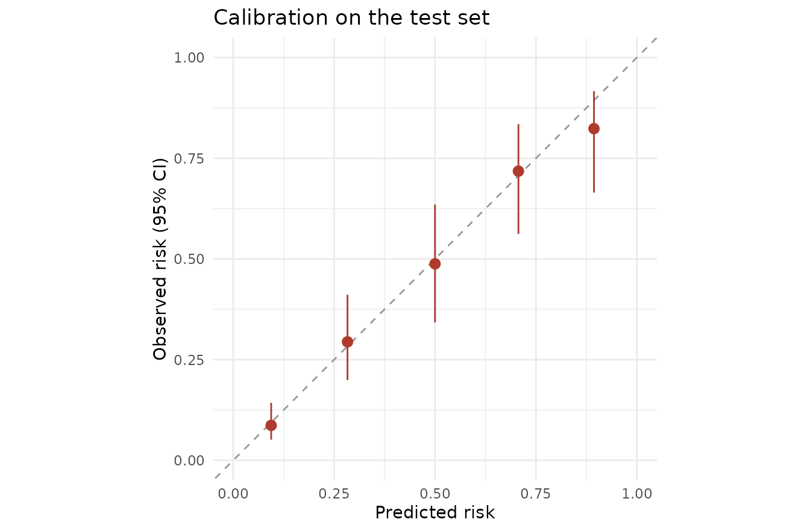
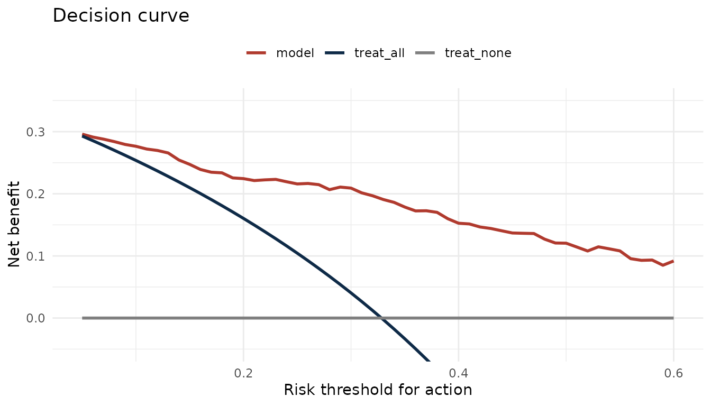

# Cohort and clinical epidemiology

``` r

library(tidyepidemio)
library(ggplot2)
red <- "#B03A2E"
navy <- "#0E2A47"
```

## 1. Smoking and coronary deaths: rates and confounding

**The study.** Male British doctors followed for ten years, with
coronary deaths and person-years by age and smoking (`british_doctors`;
Doll and Hill). **The question:** how much higher is coronary mortality
among smokers?

``` r

bd <- british_doctors
bd$rate <- 1000 * bd$deaths / bd$person_years
ggplot(bd, aes(age_group, rate, colour = factor(smoker, labels = c("Non-smoker", "Smoker")), group = smoker)) +
  geom_line(linewidth = 1) + geom_point(size = 2.5) +
  scale_colour_manual(values = c(navy, red), name = NULL) +
  scale_y_log10() +
  labs(x = "Age group", y = "Deaths per 1,000 person-years (log scale)") +
  theme_minimal() + theme(legend.position = "top")
```



``` r

models <- dplyr::bind_rows(
  epi_adjusted_rate_ratio(bd, deaths, person_years, smoker),
  epi_adjusted_rate_ratio(bd, deaths, person_years, smoker, adjust = age_group),
  epi_adjusted_rate_ratio(bd, deaths, person_years, smoker, adjust = age_group, modifier = age_group)
)
knitr::kable(models[c("modifier_level", "estimate", "conf_low", "conf_high", "interaction_p_value")],
             digits = 3)
```

| modifier_level | estimate | conf_low | conf_high | interaction_p_value |
|:---------------|---------:|---------:|----------:|--------------------:|
| NA             |    1.720 |    1.394 |     2.122 |                  NA |
| NA             |    1.426 |    1.155 |     1.759 |                  NA |
| 35-44          |    5.737 |    1.375 |    23.937 |               0.037 |
| 45-54          |    2.139 |    1.177 |     3.888 |               0.037 |
| 55-64          |    1.468 |    0.989 |     2.179 |               0.037 |
| 65-74          |    1.356 |    0.911 |     2.018 |               0.037 |
| 75-84          |    0.905 |    0.605 |     1.352 |               0.037 |

The crude rate ratio (1.72) overstates the effect because smokers in
this cohort were older on average; adjusting for age gives 1.43 (95% CI
1.15 to 1.76). The age-specific ratios show effect modification
(interaction p = 0.04): smoking multiplies coronary mortality almost
sixfold at 35-44, about twofold at 45-54, and has little relative effect
by 75-84, when the baseline risk is high in everyone.

## 2. Low birth weight: stratification, adjustment and splines

``` r

bw <- MASS::birthwt
bw$race <- factor(bw$race, labels = c("white", "black", "other"))
knitr::kable(rbind(
  cbind(analysis = "Crude", epi_odds_ratio(bw, smoke, low)[c("estimate", "conf_low", "conf_high")]),
  cbind(
    analysis = "Mantel-Haenszel by race",
    epi_mantel_haenszel(bw, smoke, low, race)[c("estimate", "conf_low", "conf_high")]
  ),
  cbind(analysis = "Logistic, age + weight + race",
        epi_adjusted_odds_ratio(bw, smoke, low, adjust = c(age, lwt, race))[c("estimate", "conf_low", "conf_high")]),
  cbind(analysis = "Logistic, spline for weight, robust SE",
        epi_adjusted_odds_ratio(bw, smoke, low, adjust = c(age, lwt, race), nonlinear = lwt,
                                robust = "HC1")[c("estimate", "conf_low", "conf_high")])
), digits = 2)
```

| analysis                               | estimate | conf_low | conf_high |
|:---------------------------------------|---------:|---------:|----------:|
| Crude                                  |     2.02 |     1.08 |      3.78 |
| Mantel-Haenszel by race                |     3.09 |     1.49 |      6.39 |
| Logistic, age + weight + race          |     2.87 |     1.36 |      6.04 |
| Logistic, spline for weight, robust SE |     2.77 |     1.29 |      5.96 |

Race confounds the crude association. The crude odds ratio is about 2;
once race is accounted for, by stratification or regression, smoking is
associated with roughly three times the odds of low birth weight, and
the estimate barely moves with a spline for maternal weight or robust
errors.

## 3. Competing risks: progression of MGUS

**The study.** 1,384 patients with monoclonal gammopathy of undetermined
significance at the Mayo Clinic
([`survival::mgus2`](https://rdrr.io/pkg/survival/man/mgus2.html)).
Patients can progress to a plasma-cell malignancy or die first.

``` r

m <- survival::mgus2
m$years <- ifelse(m$pstat == 0, m$futime, m$ptime) / 12
m$event <- ifelse(m$pstat == 0, 2 * m$death, 1)
m$ev_any <- as.integer(m$event == 1)

aj <- epi_cumulative_incidence(m, years, event, cause = 1)
km <- epi_kaplan_meier(m, years, ev_any)
compare <- rbind(
  data.frame(years = aj$time, risk = aj$cumulative_incidence, method = "Aalen-Johansen (correct)"),
  data.frame(years = km$time, risk = 1 - km$estimate, method = "1 - Kaplan-Meier (deaths censored)")
)
ggplot(compare, aes(years, risk, colour = method)) +
  geom_step(linewidth = 1) +
  scale_colour_manual(values = c(red, navy), name = NULL) +
  labs(x = "Years since diagnosis", y = "Cumulative risk of progression") +
  theme_minimal() + theme(legend.position = "top")
```



Censoring deaths overstates the risk of progression, because patients
who die can no longer progress: at 20 years the naive estimate is about
21%, twice the correct cumulative incidence of about 10%. The cumulative
incidence function answers the question patients actually ask.

## 4. Validating a diabetes risk model

Fit a logistic model on the Pima training data and evaluate it on the
independent test set
([`MASS::Pima.tr`](https://rdrr.io/pkg/MASS/man/Pima.tr.html),
[`MASS::Pima.te`](https://rdrr.io/pkg/MASS/man/Pima.tr.html)).

``` r

train <- MASS::Pima.tr
test <- MASS::Pima.te
train$dm <- as.integer(train$type == "Yes")
test$dm <- as.integer(test$type == "Yes")
fit <- glm(dm ~ glu + bmi + age + ped, binomial, train)
test$risk <- predict(fit, test, type = "response")

epi_calibration_summary(test, dm, risk)
#> # A tibble: 1 × 7
#>       n event_prevalence brier calibration_in_large calibration_intercept
#>   <int>            <dbl> <dbl>                <dbl>                 <dbl>
#> 1   332            0.328 0.142              -0.0599               -0.0855
#> # ℹ 2 more variables: calibration_slope <dbl>, roc_auc <dbl>
```

``` r

cal <- epi_calibration(test, dm, risk, bins = 5)
ggplot(cal, aes(mean_predicted, observed_risk)) +
  geom_abline(linetype = 2, colour = "grey60") +
  geom_pointrange(aes(ymin = conf_low, ymax = conf_high), colour = red) +
  coord_equal(xlim = c(0, 1), ylim = c(0, 1)) +
  labs(x = "Predicted risk", y = "Observed risk (95% CI)", title = "Calibration on the test set") +
  theme_minimal()
```



``` r

dc <- epi_decision_curve(test, dm, risk, thresholds = seq(0.05, 0.6, 0.01))
ggplot(dc, aes(threshold, net_benefit, colour = strategy)) +
  geom_line(linewidth = 1) +
  coord_cartesian(ylim = c(-0.05, 0.35)) +
  scale_colour_manual(values = c(model = red, treat_all = navy, treat_none = "grey50"), name = NULL) +
  labs(x = "Risk threshold for action", y = "Net benefit", title = "Decision curve") +
  theme_minimal() + theme(legend.position = "top")
```



The model is well calibrated (calibration slope 0.95, AUC 0.86) and
offers more net benefit than treating everyone or no one at every
threshold shown.
