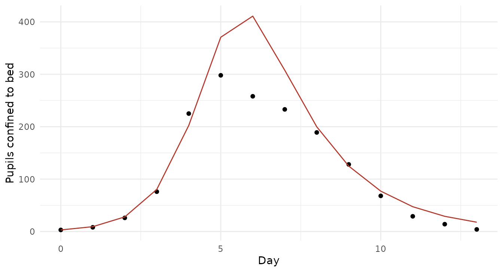

# Get started with tidyepidemio

tidyepidemio follows one rule: **a data frame goes in, a tibble comes
out**. Columns are named without quotes, as in dplyr, and every result
can be filtered, joined, plotted or tabulated like any other data.

``` r

library(tidyepidemio)
library(ggplot2)
```

## 1. A measure of association

Does smoking in pregnancy raise the risk of low birth weight? The
`birthwt` data (Hosmer and Lemeshow) record 189 births at Baystate
Medical Center, Springfield, Massachusetts, in 1986.

``` r

bw <- MASS::birthwt
epi_risk_ratio(bw, smoke, low)
#> # A tibble: 1 × 9
#>   measure    estimate conf_low conf_high exposed_events exposed_total
#>   <chr>         <dbl>    <dbl>     <dbl>          <dbl>         <dbl>
#> 1 risk_ratio     1.61     1.06      2.44             30            74
#> # ℹ 3 more variables: unexposed_events <dbl>, unexposed_total <dbl>,
#> #   correction <dbl>
epi_odds_ratio(bw, smoke, low)
#> # A tibble: 1 × 9
#>   measure    estimate conf_low conf_high exposed_events exposed_total
#>   <chr>         <dbl>    <dbl>     <dbl>          <dbl>         <dbl>
#> 1 odds_ratio     2.02     1.08      3.78             30            74
#> # ℹ 3 more variables: unexposed_events <dbl>, unexposed_total <dbl>,
#> #   correction <dbl>
```

Race confounds this association, so pool across race strata with
Mantel-Haenszel and check whether the odds ratios differ between strata:

``` r

epi_mantel_haenszel(bw, smoke, low, race)
#> # A tibble: 1 × 7
#>   estimate conf_low conf_high strata heterogeneity_statistic heterogeneity_df
#>      <dbl>    <dbl>     <dbl>  <int>                   <dbl>            <int>
#> 1     3.09     1.49      6.39      3                    3.13                2
#> # ℹ 1 more variable: heterogeneity_p_value <dbl>
```

The Breslow-Day test gives no evidence that the effect differs by race.

## 2. Adjusting for several covariates

``` r

bw$race <- factor(bw$race, labels = c("white", "black", "other"))
epi_adjusted_odds_ratio(bw, smoke, low, adjust = c(age, lwt, race))
#> # A tibble: 1 × 7
#>   measure             estimate conf_low conf_high     n se_type adjusted_for  
#>   <chr>                  <dbl>    <dbl>     <dbl> <int> <chr>   <chr>         
#> 1 adjusted_odds_ratio     2.87     1.36      6.04   189 model   age, lwt, race
```

The same call accepts `weights`, `robust = "HC1"`, `cluster`, an effect
`modifier` and spline terms through `nonlinear`.

## 3. An outbreak

The 1978 boarding-school influenza outbreak is the textbook SIR example:

``` r

flu <- transform(flu_boarding_school_1978, day = 0:13)
fit <- epi_fit_compartmental(flu, day, in_bed, population = 763, gamma = 0.5)
generics::tidy(fit)
#> # A tibble: 2 × 3
#>   term  estimate fixed
#>   <chr>    <dbl> <lgl>
#> 1 beta      2.49 FALSE
#> 2 gamma     0.5  TRUE

ggplot(generics::augment(fit), aes(day)) +
  geom_point(aes(y = in_bed)) +
  geom_line(aes(y = .fitted), colour = "#B03A2E") +
  labs(x = "Day", y = "Pupils confined to bed") +
  theme_minimal()
```



## Statistical advice

[`tep_advise()`](https://tidyepidemio.in4metrix.dev/reference/tep_advise.md)
says which estimator answers the question and what to check first;
[`tep_interpret()`](https://tidyepidemio.in4metrix.dev/reference/tep_advise.md)
explains a result, says what to do next and how to report it in a paper.
With the tidyvisor package installed, `tidyvisor()` calls them for you.

``` r

d <- data.frame(exposure = rep(0:1, each = 40),
                outcome = rep(c(0, 1, 0, 1), c(30, 10, 18, 22)))
tep_advise(d, exposure = "exposure", outcome = "outcome")
#> 
#> ── tidyvisor: is the exposure associated with the outcome? ─────────────────────
#> Question: association
#> 
#> ── What the data show ──
#> 
#> • Records: 80
#> • Outcome events: 32 of 80 (40.0%) — common outcome (over 10%): odds ratios
#>   exaggerate risk ratios; report the risk ratio
#> • Exposure groups: 0: 40, 1: 40
#> 
#> ── Recommended ──
#> 
#> Estimate: Risk ratio (cohort) or odds ratio (case-control)
#> The design decides the measure: risks in cohorts and trials, odds in
#> case-control studies; rates when follow-up time differs.
#> epi_risk_ratio(data, exposure, outcome)   # or epi_odds_ratio(), epi_rate_ratio()
#> Confounding: Stratify or adjust
#> A crude ratio mixes the exposure with whatever travels with it; compare it with
#> the Mantel-Haenszel or adjusted ratio.
#> epi_mantel_haenszel(data, exposure, outcome, <stratum>)
#> Small numbers: Exact test when cells are small
#> With expected counts below 5, use an exact test and interval.
#> epi_fisher_test(data, exposure, outcome)
tep_interpret(epi_risk_ratio(d, exposure, outcome))
#> 
#> ── tidyvisor: what the results show ────────────────────────────────────────────
#> 
#> ── Result ──
#> 
#> • The risk ratio is 2.2 (95% CI 1.2 to 4.03). The risk of the outcome is 120%
#>   higher in the exposed than in the unexposed.
#> • A crude estimate: confounding is not removed.
#> 
#> ── After the overall test ──
#> 
#> • Check that the association is not explained by confounding: stratify
#>   (epi_mantel_haenszel()) or adjust (epi_adjusted_risk_ratio(),
#>   epi_adjusted_odds_ratio()) for the confounders named in advance, and report
#>   crude and adjusted estimates side by side.
#> • With several exposure levels, report each against the same reference group,
#>   and test for a trend if the levels are ordered, rather than testing every
#>   pair.
#> 
#> ── For the paper ──
#> 
#> • Results: 'The risk ratio for exposure was 2.2 (95% CI 1.2 to 4.03).'
#> • Report the estimate with its 95% CI (and the counts behind it), not the
#>   p-value alone; give crude and adjusted estimates side by side.
#> • Figure: a forest plot of the estimates with their intervals on a log scale,
#>   with a line at 1:
#> • ggplot2::autoplot(result)
#> • ggplot2::ggsave("figure1.pdf", width = 85, height = 70, units = "mm") # one
#>   journal column
#> • Figure style for journals: one column (about 85 mm) or the page (about 180
#>   mm); axes labelled with units; a color-blind-safe palette; intervals shown,
#>   with what they are stated in the caption; text at least 8 pt; vector PDF.
#> • Table: exposed and unexposed with events and totals (or person-time), the
#>   crude and adjusted estimates with intervals, and what was adjusted for.
#> • Methods: the design (cohort, case-control, cross-sectional), the measure and
#>   why, the interval method, the confounders and how they were chosen; follow
#>   STROBE for observational studies, and the software (R 4.6.2, tidyepidemio
#>   1.2.0.9000; citation("tidyepidemio")).
```

## Where next

The articles on the package website work through complete analyses on
real data:

- *COVID-19 outbreak analysis*: epidemic curves, growth, R_(t) and
  forecasting for New Zealand’s first wave.
- *Cluster detection and surveillance*: SIDS clusters in North Carolina,
  COVID-19 across New York State and seasonal mortality screening.
- *Cohort and clinical epidemiology*: the British Doctors Study,
  competing risks in MGUS and a diabetes risk model.
